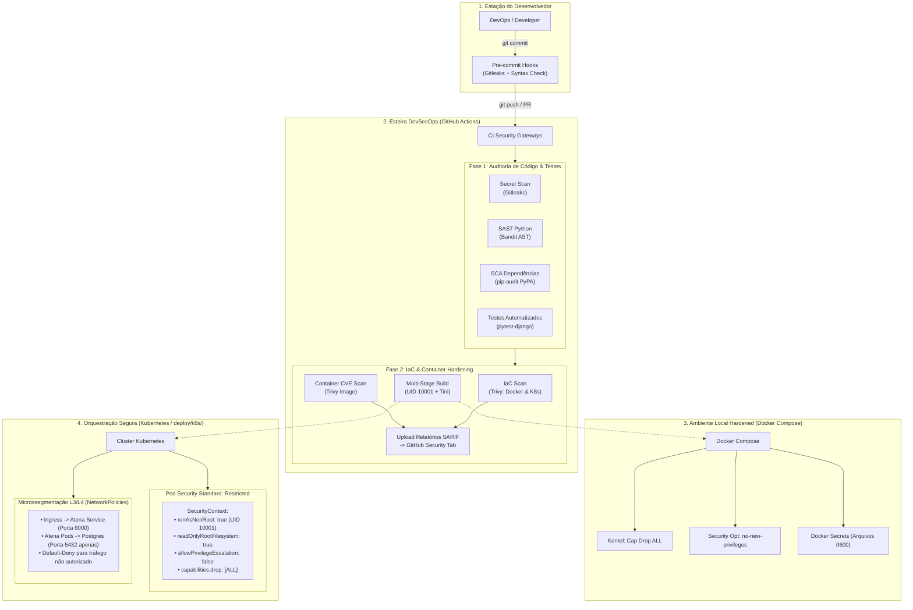

# 🛡️ Atena ERP — DevSecOps & Cloud-Native Showcase

[](https://github.com/PedroMarineli/atena/actions/workflows/devsecops.yml)
[](https://kubernetes.io/docs/concepts/security/pod-security-standards/)
[](https://github.com/gitleaks/gitleaks)
[](https://github.com/aquasecurity/trivy)
[](https://github.com/PyCQA/bandit)
[](https://www.python.org/)
[](https://www.djangoproject.com/)

> **Case de Portfólio DevOps / DevSecOps:** Implementação de uma arquitetura de Defesa em Profundidade (*Defense-in-Depth*) e modelo *Zero-Trust* para uma aplicação corporativa (Django ERP + PostgreSQL), cobrindo desde a prevenção no commit até a orquestração segura em Kubernetes.

---

## 📌 Visão Geral da Arquitetura DevSecOps



---

## 🛡️ Matriz de Defesa em Profundidade (*Defense-in-Depth*)

| Camada | Mecanismo de Segurança | Ferramenta / Implementação | Objetivo |
| :--- | :--- | :--- | :--- |
| **Commit** | Secret Scanning no Git | `pre-commit` + `Gitleaks` | Bloquear commit acidental de senhas e tokens na máquina local |
| **Código (SAST)** | Análise Estática de Segurança | `Bandit` (AST Scanner) | Identificar falhas de segurança no código Python (SQLi, eval, insecure configs) |
| **Dependências (SCA)** | Auditoria de CVEs conhecidas | `pip-audit` | Validar pacotes contra a base oficial do PyPA Advisory Database |
| **Container (Build)** | Multi-Stage & Imagem Limpa | `Dockerfile` (Builder -> Runtime) | Eliminar compiladores (`gcc`, `make`) da imagem final de produção |
| **Container (Privilégio)** | Princípio do Menor Privilégio | `USER 10001:10001` (appuser) | Execução 100% rootless; contenção contra escape de container |
| **Container (Kernel)** | Hardening de Privilégios | `no-new-privileges`, `cap_drop: ALL` | Impedir escalada de privilégios via `setuid` no Linux |
| **Processos (PID 1)** | Signal Forwarding & Zombie Reaper | `Tini` (`/usr/bin/tini`) | Evitar exaustão de descritores de processo zumbi no kernel |
| **Cluster (K8s)** | Pod Security Standards | `PSS Restricted` | Bloquear pods com privilégios de root, mounts perigosos e escrita em disco raiz |
| **Rede (Zero-Trust)** | Microssegmentação L3/L4 | `NetworkPolicies` | Isolar tráfego leste-oeste: PostgreSQL só aceita conexões do Pod do Django |
| **Credenciais** | Gestão de Segredos | `Docker Secrets` / `K8s Secrets` | Eliminar variáveis de ambiente em texto puro no docker-compose |
| **Confiabilidade** | Probes de Saúde Operacional | `/healthz` (Live) e `/ready` (DB Check) | Permitir orquestração resiliente e auto-recuperação de containers |

---

## 🚀 Como Executar Localmente com Hardening

### 1. Pré-requisitos
- [Docker](https://docs.docker.com/get-docker/) & [Docker Compose](https://docs.docker.com/compose/)
- Python 3.10+ (ou OpenSSL) para geração de segredos locais

### 2. Gerar Segredos Seguros
Antes de iniciar os containers, gere credenciais criptográficas fortes isoladas na pasta `.secrets/` (automaticamente ignorada pelo Git):

```bash
# Via Python (Multiplataforma)
python scripts/generate_secrets.py

# Ou via Bash (Linux/macOS)
chmod +x scripts/generate-secrets.sh
./scripts/generate-secrets.sh
```

### 3. Subir o Ambiente Seguro via Docker Compose
```bash
docker compose up -d --build
```

O ambiente inicializará:
- **`atena-postgres`**: PostgreSQL 15 Alpine rodando com credenciais injetadas via Docker Secrets (`/run/secrets/`), sem porta 5432 exposta na interface do host e com `no-new-privileges`.
- **`atena-django`**: Container executando sob o usuário `appuser` (UID 10001), executando migrações e servindo na porta local `127.0.0.1:8888`.

### 4. Validar os Health Checks
```bash
# Liveness Probe (processo vivo)
curl http://localhost:8888/healthz

# Readiness Probe (conexão ativa com PostgreSQL)
curl http://localhost:8888/ready
```

---

## ☸️ Deploy em Kubernetes com Zero-Trust (`deploy/k8s/`)

Os manifestos estão estruturados para atender ao nível **Restricted** do Pod Security Standards do Kubernetes:

```bash
# 1. Aplicar Namespace e políticas de segurança
kubectl apply -f deploy/k8s/namespace.yaml

# 2. Criar ConfigMap e Secrets
kubectl apply -f deploy/k8s/configmap.yaml
# (Crie o secret com suas credenciais ou use o template)
kubectl apply -f deploy/k8s/secret.yaml.example

# 3. Aplicar Banco de Dados e Serviços
kubectl apply -f deploy/k8s/postgres.yaml
kubectl apply -f deploy/k8s/deployment.yaml
kubectl apply -f deploy/k8s/service.yaml

# 4. Ativar Políticas de Rede Zero-Trust (Microssegmentação)
kubectl apply -f deploy/k8s/networkpolicy.yaml
kubectl apply -f deploy/k8s/ingress.yaml

# Ou aplicar tudo via Kustomize:
kubectl apply -k deploy/k8s/
```

### Validando a Restrição de Segurança no Pod:
```bash
# Verificar que o container roda como non-root
kubectl exec -it -n atena deploy/atena-app -c atena -- id
# Saída esperada: uid=10001(appuser) gid=10001(appgroup)

# Verificar que o sistema de arquivos raiz é Read-Only
kubectl exec -it -n atena deploy/atena-app -c atena -- touch /test_file
# Saída esperada: touch: cannot touch '/test_file': Read-only file system
```

---

## 🧪 Executando Testes e Scanners de Segurança Localmente

```bash
# 1. Instalar dependências de auditoria
pip install -r requirements.txt
pip install pytest pytest-django bandit[toml] pip-audit pre-commit

# 2. Executar testes unitários e de integração
pytest -v

# 3. Executar SAST com Bandit
bandit -c pyproject.toml -r core inventory sales finance dashboard -ll

# 4. Executar verificação de CVEs com pip-audit
pip-audit -r requirements.txt --desc on

# 5. Ativar hooks de commit para prevenir vazamento de segredos
pre-commit install
```

---

## 📂 Estrutura do Repositório

```text
atena/
├── .github/
│   └── workflows/
│       └── devsecops.yml       # Pipeline CI/CD: Gitleaks, SAST, SCA, Tests, Trivy SARIF
├── deploy/
│   └── k8s/                    # Manifestos Kubernetes PSS Restricted & Zero-Trust
│       ├── namespace.yaml      # Namespace com label pod-security.kubernetes.io/enforce: restricted
│       ├── configmap.yaml      # Variáveis operacionais não sensíveis
│       ├── secret.yaml.example # Template seguro para credenciais
│       ├── postgres.yaml       # StatefulSet + ClusterIP Service + PVC
│       ├── deployment.yaml     # Deployment com SecurityContext rootless e readOnlyRootFilesystem
│       ├── service.yaml        # Service ClusterIP
│       ├── networkpolicy.yaml  # Microssegmentação L3/L4 (Zero-Trust)
│       ├── ingress.yaml        # Ponto de entrada Ingress Nginx
│       └── kustomization.yaml  # Automação de deploy com kubectl apply -k
├── scripts/
│   ├── generate_secrets.py     # Gerador criptográfico multiplataforma para .secrets/
│   └── generate-secrets.sh     # Wrapper POSIX para automação em Linux/macOS
├── core/
│   ├── health.py               # Endpoints /healthz e /ready para Probes K8s
│   ├── tests.py                # Testes automatizados das sondas de saúde
│   └── settings.py             # Suporte a Docker Secrets e OWASP Security Headers
├── Dockerfile                  # Multi-stage hardened build (UID 10001, Tini, Healthcheck)
├── docker-compose.yml          # Compose seguro com Docker Secrets, cap_drop e no-new-privileges
├── .pre-commit-config.yaml     # Hooks de commit (Gitleaks, Bandit, linters)
├── pyproject.toml              # Configurações do Bandit SAST
└── requirements.txt            # Dependências do projeto
```

---

## 👤 Autor

**Pedro Marineli**  
- GitHub: [@PedroMarineli](https://github.com/PedroMarineli)
